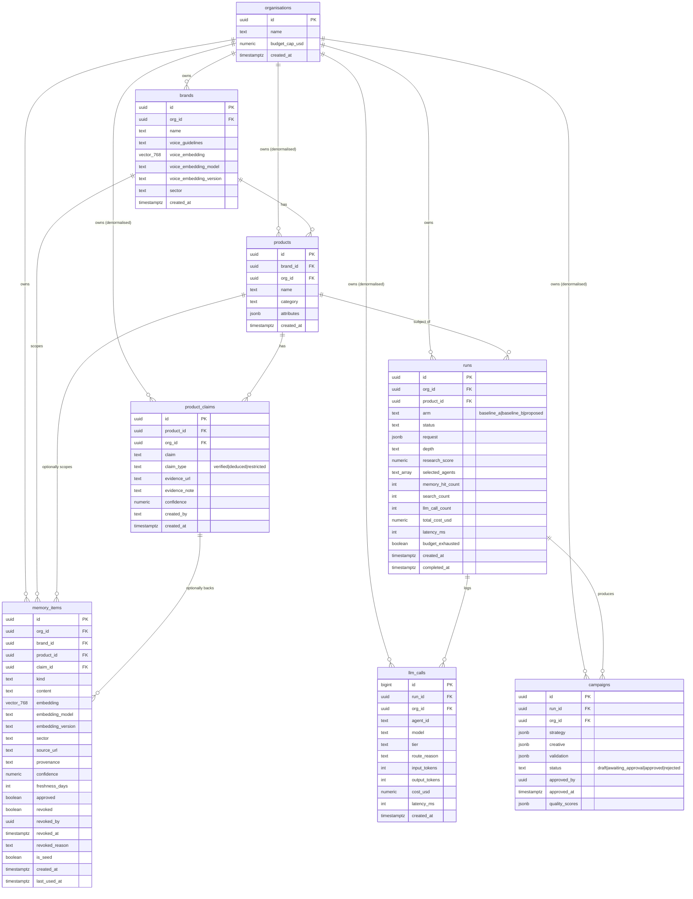

# BrandverseAI — Data Model (ERD draft)

| Field | Value |
|---|---|
| Phase | 0 — accepted 2026-10-14 |
| Status | **Canonical.** `Architecture.md` §9 is reconciled to this document and must change in the same commit as it. |
| Date | 14 October 2026 |

This is the canonical data model. It is not a migration; the Phase 1 migrations implement it.
Composite `on delete set null (col)` (§3) requires PostgreSQL 15+.

## 1. Diagram

## 2. Issues found against `Architecture.md` §9

IDs are the ones assigned when this list was first drafted.

| # | Issue | Why it matters | Resolution | Status |
|---|---|---|---|---|
| E1 | `products`, `product_claims`, `llm_calls`, `campaigns` have no `org_id` | Rules.md P3/P4 and §9's RLS rule are written against `org_id`; without it RLS needs join-based policies | Denormalised `org_id uuid not null` on all four, direct RLS policy `org_id = (auth.jwt() ->> 'org_id')::uuid`. No join-based policies. Consistency enforced by composite FKs — see §3. | **Accepted 2026-10-14** |
| E2 | `memory_items` has no `embedding_model` / `embedding_version` | `Memory.md` §5 requires them from day one | Add both, `text`. Nullable because `embedding` is nullable; check constraint: both non-null whenever `embedding` is non-null. | **Accepted 2026-10-14** |
| E3 | `brands.voice_embedding` has no model/version columns | Same drift risk as E2, for the brand-voice gate | Add `voice_embedding_model`, `voice_embedding_version` (`text`); check constraint: both non-null whenever `voice_embedding` is non-null | **Accepted 2026-10-14** |
| E4 | No revocation audit columns | `Memory.md` §6.4 requires who revoked what and when | Add `revoked_by uuid`, `revoked_at timestamptz`, `revoked_reason text` to `memory_items`; check constraint: when `revoked`, `revoked_by` and `revoked_at` are non-null | **Accepted 2026-10-14** |
| E5 | No link from `memory_items` (`kind='claim'`) to `product_claims` | Decay exemption in `Memory.md` §3.3 keys on `claim_type`, which lives only on `product_claims` | Add nullable `memory_items.claim_id`, composite FK `(claim_id, org_id) → product_claims (id, org_id)`, `on delete set null (claim_id)` | **Accepted 2026-10-14** |
| E6 | `provenance = 'seed'` is the only seed marker | `Rules.md` A3 requires seed exclusion enforced in code; free text is fragile | Add `is_seed boolean not null default false` | **Accepted 2026-10-14** |
| E7 | `runs.product_id`, `memory_items.brand_id`, `memory_items.product_id` reference parents without an `org_id` check | A run or memory item in Org A can point at Org B's product or brand; RLS on the child does not catch it | Composite FKs to the parents' `unique (id, org_id)`, same pattern as E1 — see §3 | **Accepted 2026-10-14** |

## 3. Keeping `org_id` consistent across references (E1, E5, E7)

A copied `org_id` can disagree with its parent — e.g. a product whose `org_id` is Org B under a
brand owned by Org A. That would be a tenant-isolation hole that RLS cannot see. It is prevented in
the schema, not in application code:

| Child | Constraint |
|---|---|
| `brands` | `unique (id, org_id)` (target for the FK below) |
| `products` | `foreign key (brand_id, org_id) references brands (id, org_id)` |
| `products` | `unique (id, org_id)` |
| `product_claims` | `foreign key (product_id, org_id) references products (id, org_id)` |
| `runs` | `unique (id, org_id)` |
| `llm_calls` | `foreign key (run_id, org_id) references runs (id, org_id)` |
| `campaigns` | `foreign key (run_id, org_id) references runs (id, org_id)` |
| `product_claims` | `unique (id, org_id)` (target for E5) |
| `runs` | `foreign key (product_id, org_id) references products (id, org_id)` (E7) |
| `memory_items` | `foreign key (brand_id, org_id) references brands (id, org_id) on delete cascade` (E7) |
| `memory_items` | `foreign key (product_id, org_id) references products (id, org_id) on delete set null (product_id)` (E7) |
| `memory_items` | `foreign key (claim_id, org_id) references product_claims (id, org_id) on delete set null (claim_id)` (E5) |

`on delete set null (col)` nulls only the named column. A plain `on delete set null` on a composite
FK would also null `org_id`, which is `not null`, and the parent delete would fail.

Nullable reference columns use the default `MATCH SIMPLE`: when the reference column is null the
FK is not checked, which is intended for org-wide memory items and product-less runs.

The cross-tenant test in Phase 1 must include an attempt to insert a child row whose `org_id`
differs from its parent's, and assert it is rejected.
