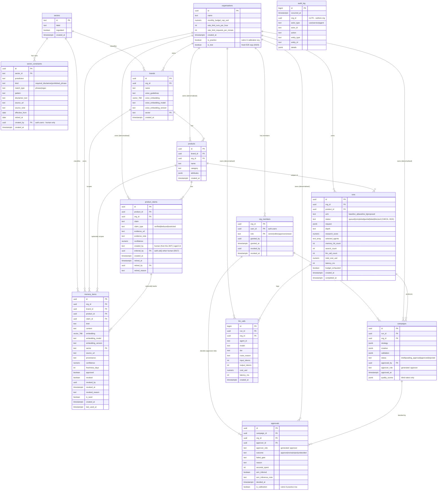

# BrandverseAI — Data Model (ERD draft)

| Field | Value |
|---|---|
| Phase | 0 — accepted 2026-10-14 |
| Status | **Canonical.** `Architecture.md` §9 is reconciled to this document and must change in the same commit as it. |
| Date | 14 October 2026 |

This is the canonical data model. The full DDL is in `Architecture.md` §9; the Phase 1
migrations are cut from it.
Composite `on delete set null (col)` (§3) requires PostgreSQL 15+.

## 1. Diagram

## 2. Issues found against `Architecture.md` §9

IDs are the ones assigned when this list was first drafted.

| # | Issue | Why it matters | Resolution | Status |
|---|---|---|---|---|
| E1 | `products`, `product_claims`, `llm_calls`, `campaigns` have no `org_id` | Rules.md P3/P4 and §9's RLS rule are written against `org_id`; without it RLS needs join-based policies | Denormalised `org_id uuid not null` on all four, RLS on the row's own `org_id` — no parent-table walking. Since E8 the policy also checks the caller's role (`app.has_role`). Consistency enforced by composite FKs — see §3. | **Accepted 2026-10-14** |
| E2 | `memory_items` has no `embedding_model` / `embedding_version` | `Memory.md` §5 requires them from day one | Add both, `text`. Nullable because `embedding` is nullable; check constraint: both non-null whenever `embedding` is non-null. | **Accepted 2026-10-14** |
| E3 | `brands.voice_embedding` has no model/version columns | Same drift risk as E2, for the brand-voice gate | Add `voice_embedding_model`, `voice_embedding_version` (`text`); check constraint: both non-null whenever `voice_embedding` is non-null | **Accepted 2026-10-14** |
| E4 | No revocation audit columns | `Memory.md` §6.4 requires who revoked what and when | Add `revoked_by uuid`, `revoked_at timestamptz`, `revoked_reason text` to `memory_items`; check constraint: when `revoked`, `revoked_by` and `revoked_at` are non-null | **Accepted 2026-10-14** |
| E5 | No link from `memory_items` (`kind='claim'`) to `product_claims` | Decay exemption in `Memory.md` §3.3 keys on `claim_type`, which lives only on `product_claims` | Add nullable `memory_items.claim_id`, composite FK `(claim_id, org_id) → product_claims (id, org_id)`, `on delete set null (claim_id)` | **Accepted 2026-10-14** |
| E6 | `provenance = 'seed'` is the only seed marker | `Rules.md` A3 requires seed exclusion enforced in code; free text is fragile | Add `is_seed boolean not null default false` | **Accepted 2026-10-14** |
| E7 | `runs.product_id`, `memory_items.brand_id`, `memory_items.product_id` reference parents without an `org_id` check | A run or memory item in Org A can point at Org B's product or brand; RLS on the child does not catch it | Composite FKs to the parents' `unique (id, org_id)`, same pattern as E1 — see §3 | **Accepted 2026-10-14** |

| E8 | No role-based access: any org member could do anything | An approver gate (T6) is meaningless if every member can approve; viewers must not edit product truth | `org_members (org_id, user_id, role)` with roles owner/editor/approver/viewer; roles revoked, never deleted (no application role can delete since 0010; the table owner can — `Architecture.md` §9, stated limitation); every tenant RLS policy checks role via `app.has_role` (§4) | **Accepted 2026-10-14** |
| E9 | No general audit trail | Who changed what is needed for approvals, revocations and registry edits; retrofitting loses history | `audit_log`, append-only: update/delete/truncate revoked from all app roles and rejected by a trigger. **Limitation (2026-10-14):** the table owner (`postgres` on Supabase) can disable the trigger; append-only binds the application roles only (`Architecture.md` §9) | **Accepted 2026-10-14** |
| E10 | Only a per-run cost cap; `budget_cap_usd` had no stated period | One organisation could start unbounded runs, each under the per-run cap | `monthly_budget_cap_usd`, `rate_limit_runs_per_hour`, `rate_limit_requests_per_minute` on `organisations`; checked alongside the per-run cap (`Architecture.md` §9). `budget_cap_usd` renamed — no data existed. | **Accepted 2026-10-14** |
| E11 | Regulated-sector safety depended on an agent (A4) not built in Phase 6 | Required disclaimers / prohibited phrasings must not depend on generation | `sector_constraints` registry (human-authored, versioned, never edited in place or deleted) and a `sectors` table that `brands.sector` and `memory_items.sector` reference, so a misspelled sector cannot bypass the registry | **Accepted 2026-10-14** |
| E12 | RLS required an `org_id` claim in the JWT (one active org per token, set by a custom access token hook) | A single org claim forces one organisation per user, contradicting the agency persona (`PRD.md` §3) and any consultant working across client orgs; it also needed a hook to maintain | No org claim. Membership is resolved from `org_members` keyed on `auth.uid()`, always written `(select auth.uid())` so it is evaluated once per statement. Reads: `org_id in (select app.member_org_ids())`, likewise evaluated once per statement; role-specific writes: `app.has_role(org_id, roles)`; both stable `security definer`. **The custom access token hook is no longer required and is not built.** The org a request is for is an explicit API parameter, filtered on per `Rules.md` P3 | **Accepted 2026-10-14** |
| E13 | Approval decisions had nowhere to live | `campaigns` records only an approval (`approved_by`), not revise / reject / undecided, time spent or arm inference (`docs/approval-rubric.md` §5); `quality_scores` holds the blind raters' scores and must not mix in the approver's decision | `approvals` (migration 0009), one append-only row per decision (application roles only — since 0010 none of them can delete the `runs` or `organisations` rows that would cascade into it; not against the table owner — `Architecture.md` §9, stated limitation); composite FK to `campaigns (id, org_id)`; approver constrained as for `campaigns.approved_by` (role FK + active-approver trigger); reason required unless `approve`; no failed gate on `approve`; a note required when `arm_inferred`. `is_calibration boolean not null default false` flags the rubric §6 calibration decisions, made in a practice organisation where the second scorer holds `approver` only there; they are excluded from evaluation by the harness filter on the flag (as `is_seed`, E6), never deleted and never filtered by org id, which changes on a reseed. The practice organisation is marked `organisations.is_practice` (backend-set; owners' column-level `update` excludes it); a trigger rejects any approval in a practice org whose `is_calibration` is false, and the harness also excludes practice orgs, so an unflagged practice row can neither be written nor leak. Added now rather than before Phase 6, so it is never retrofitted onto populated tables | **Accepted 2026-10-14** |
| E14 | Application roles could delete rows the design keeps | `service_role` could hard-delete `memory_items` (`Memory.md` §6.4) and delete `runs` / `organisations`, cascading into `campaigns` and `approvals`; Supabase's default privileges grant `delete` and `truncate` on every new table to all three API roles | Migration 0010 (correctness fix, 2026-10-14): `delete` and `truncate` revoked on `memory_items`, `runs`, `campaigns`, `organisations`, `org_members` from `anon`, `authenticated`, `service_role`; deleting an organisation is a manual `postgres` procedure (`Architecture.md` §9). Remaining gaps (brand cascade into memory, `llm_calls`, `sector_constraints` truncate) listed there | **Accepted 2026-10-14** |
| E15 | Delete paths 0010 did not close | `llm_calls` (raw logs) deletable and truncatable by `service_role`; `sector_constraints` truncatable (its trigger fires on DELETE only); `TRUNCATE` granted on every table by Supabase's default privileges; deleting a brand cascaded into its memory items | Migration 0011 (correctness fix, 2026-10-14): `delete`/`truncate` revoked on `llm_calls`, `sector_constraints`, `sectors`; `truncate` revoked everywhere; `memory_items.brand_id` becomes `on delete no action` (a brand with memory cannot be deleted, as a product with runs cannot). The class is closed by `test_table_posture.py`, which states every table's posture and fails on an unlisted table | **Accepted 2026-10-14** |
| E16 | A new user had no way to a first organisation | `organisations` has no insert policy and adding a member needs an existing owner, so sign-up could not lead anywhere | Migration 0012: `app.create_organisation(name)` — name only (the owner is the caller, read from the JWT claims with `auth.uid()`'s exact expression, which the migration checks); security definer owned by `app_org_creator`, a NOLOGIN role with INSERT on `organisations` and `org_members` only, bound by two insert policies; executable by `authenticated` only. Stated in `test_table_posture.py` (functions and the role), tested in `test_create_organisation.py`. No cap on organisations per user (accepted) | **Accepted 2026-10-16** |
| E17 | Budget enforcement and the audit log could disagree; waits were not recorded | Rules.md A1 requires every reported number to trace to a raw log, so caps (C3), daily quota (C9) and RPM pacing (C10) must be queries of `llm_calls`, not a counter; concurrent calls must not both pass a check one should fail; C10 waits must be kept apart from latency | Migration 0013: `rate_limit_wait_ms`; `outcome` (`pending` reservation written in the admission transaction under an advisory lock, then `ok` / `invalid_output` / `error` / `rate_limited`; `refused` records a pre-flight refusal and is never counted); `finished_at`. Tested in `test_llm_ledger.py` (incl. a concurrency test that fails without the lock) | **Accepted 2026-10-17** |
| E18 | No record of which prompt produced a call | Without it the evaluation cannot show that every run in an arm used the same prompts; a prompt edited mid-evaluation would silently invalidate the comparison (Rules.md A5, A6) | Migration 0014: `prompt_id`, `prompt_version` on `llm_calls`, NOT NULL, format-checked; versions are immutable files locked by hash (`config/prompts/versions.lock`). Detection is a query: `app/evaluation/prompt_versions.py` flags more than one version per prompt within an arm, or different versions across arms. Tested in `test_prompt_versions.py`, `test_llm_ledger.py`, `test_llm_prompts.py` | **Accepted 2026-10-17** |
| E19 | Product truth constraints were labels only, and provenance was caller-supplied | `claim_type` was checked, but nothing tied `verified` to evidence or to a human; members can insert `product_claims` through the REST API, so `created_by = 'human'` was forgeable; claims could be edited or deleted after a campaign cited them; a user could insert a run already `blocked` or costed | Migrations 0015–0019 (Phase 3 chunk A): `runs.status` CHECK incl. `blocked`; user-inserted runs forced to the initial state; per-type CHECKs on `product_claims` (verified = human + http(s) URL; deduced = confidence + basis; restricted = reason); `entered_by`, `retired_at`, `retired_by`, `retired_reason`, set by a trigger from `auth.uid()`; claims retired, never edited or deleted; sector keys seeded; brand sector changes audited by a security-definer trigger owned by `app_audit_writer`. General rule: `Architecture.md` §9, "Trust-deciding columns" | **Accepted 2026-10-17** |
| E20 | Test organisations were kept out of evaluation only by nobody passing their ids | The live project's fixed E2E organisations and their lasting run fixture can never be deleted (0010, 0017), so they must be excluded by a property, not by remembered ids, which are environment-specific | Migration 0020: `organisations.is_test boolean not null default false`, backend-set (owners' column-level update excludes it; the 0012 bootstrap's insert policy refuses it). Every evaluation read filters `not o.is_practice and not o.is_test`; `test_test_organisations.py` checks each read, a control with the flag off, and that every `*_SQL` read carries both filters | **Accepted 2026-10-17** |

`campaigns.approved_by` is additionally constrained (E8 + T6): FK on
`(org_id, approved_by, approver_role)` → `org_members (org_id, user_id, role)` with
`approver_role` generated as `'approver'`, plus a trigger rejecting a revoked approver.

## 3. Keeping `org_id` consistent across references (E1, E5, E7)

A copied `org_id` can disagree with its parent — e.g. a product whose `org_id` is Org B under a
brand owned by Org A. That would be a tenant-isolation hole that RLS cannot see. It is prevented in
the schema, not in application code:

| Child | Constraint |
|---|---|
| `brands` | `unique (id, org_id)` (target for the FK below) |
| `products` | `foreign key (brand_id, org_id) references brands (id, org_id)` |
| `products` | `unique (id, org_id)` |
| `product_claims` | `foreign key (product_id, org_id) references products (id, org_id)` |
| `runs` | `unique (id, org_id)` |
| `llm_calls` | `foreign key (run_id, org_id) references runs (id, org_id)` |
| `campaigns` | `foreign key (run_id, org_id) references runs (id, org_id)` |
| `product_claims` | `unique (id, org_id)` (target for E5) |
| `runs` | `foreign key (product_id, org_id) references products (id, org_id)` (E7) |
| `memory_items` | `foreign key (brand_id, org_id) references brands (id, org_id)` — no delete action since 0011 (E7, E15); was `on delete cascade` |
| `memory_items` | `foreign key (product_id, org_id) references products (id, org_id) on delete set null (product_id)` (E7) |
| `memory_items` | `foreign key (claim_id, org_id) references product_claims (id, org_id) on delete set null (claim_id)` (E5) |
| `campaigns` | `unique (id, org_id)` (target for E13; added in 0009) |
| `approvals` | `foreign key (campaign_id, org_id) references campaigns (id, org_id) on delete cascade` (E13) |

`on delete set null (col)` nulls only the named column. A plain `on delete set null` on a composite
FK would also null `org_id`, which is `not null`, and the parent delete would fail.

Nullable reference columns use the default `MATCH SIMPLE`: when the reference column is null the
FK is not checked, which is intended for org-wide memory items and product-less runs.

### Required before the first migration

- [x] **Confirm the Supabase project runs PostgreSQL 15 or later** (`select version();`), and
  record the version and date here. **Confirmed 2026-10-14: PostgreSQL 17.11.** Migrations
  0001–0009 were applied the same day (`Architecture.md` §11). `on delete set null (product_id)` and
  `on delete set null (claim_id)` on `memory_items` depend on it; on PostgreSQL 14 or earlier the
  migration fails. No migration is applied until this box is ticked.

The cross-tenant test in Phase 1 must include an attempt to insert a child row whose `org_id`
differs from its parent's, and assert it is rejected.

## 4. Role matrix (enforced by RLS)

Roles are held per organisation; a user who belongs to several organisations has, in each, only
the roles granted there (E12).

| Table | viewer | approver | editor | owner | Backend (service role) |
|---|---|---|---|---|---|
| `organisations` | read | read | read | read, update (not `is_practice`, `is_test`) | all but delete/truncate (0010) |
| `org_members` | read | read | read | read, add, revoke | all but delete/truncate (0010) |
| `brands`, `products` | read | read | read, insert, update | + delete¹ | all |
| `product_claims` | read | read | read, enter, retire (who and when from the JWT, 0017) | same; never edit or delete | agent claims (never `verified`), no edit, no delete |
| `runs` | read | read | read, start (status, counts, cost forced to the initial state, 0016) | same | status updates |
| `llm_calls` | read | read | read | read | insert |
| `memory_items` | read | read | read, **revoke only** | read, **revoke only** | insert (after approval, `Rules.md` P8) |
| `campaigns` | read | read | read | read | write; approval must name an active approver (FK + trigger) |
| `approvals` | read | read | read | read | **insert only**; approver must be an active approver (FK + trigger) |
| `audit_log` | — | — | — | read own org | **insert only** |
| `sectors`, `sector_constraints` | read | read | read | read | admin path writes |

¹ A product (and so its brand) that has runs cannot be deleted by anyone: `runs` are the
evaluation's raw logs (`Rules.md` A1) and the `runs → products` FK has no delete action. Since
0011 the same holds for a brand that has memory items (E15). No application role holds `TRUNCATE`
on any table; `backend/tests/db/test_table_posture.py` states every table's posture.

"Revoke only": `authenticated` holds column-level `update` on the four revocation columns of
`memory_items` and nothing else, and the policy requires
`revoked_by = (select auth.uid())`.

## 5. Schema test record

The schema is tested by `backend/tests/db/` (merge-blocking, `Rules.md` §6), which applies
`supabase/migrations/` **unmodified** to `pgvector/pgvector:pg17` (pinned by digest in CI) after a
test-only platform stub (`backend/tests/db/supabase_platform_stub.sql`): Supabase's API roles and
default grants, a minimal `auth.users`, and `auth.uid()` / `auth.jwt()` copied verbatim from
Supabase's own auth migrations.
Requests are simulated the way PostgREST does it: `set local role
authenticated` plus the `request.jwt.claims` GUC. Policy text under test is the deployed text.

| Date | Environment | Result |
|---|---|---|
| 2026-10-14 | Scratch harness, PostgreSQL 16.2 (embedded), pgvector/pg_trgm stripped | 39/39 — superseded: the harness pre-created schema `app` with grants, masking finding F1 |
| 2026-10-14 | `backend/tests/db/` on PostgreSQL 16.2 (embedded) with migrations copied to a scratch dir and pgvector/pg_trgm/HNSW stripped (logic check only, not the gate) | 55 passed; 2 failed as expected (extension and HNSW tests need real pgvector) |
| 2026-10-14 | After E12/E13: same embedded PostgreSQL 16.2 logic check (pgvector, pg_trgm and HNSW stripped from a scratch copy) | 80 passed; 2 failed as expected (extension and HNSW tests need real pgvector) |
| 2026-10-14 | `backend/tests/db/` on `pgvector/pgvector:pg17` (pinned digest), GitHub Actions run 38571548270 at `7266cec` | **Passed** — the merge-blocking gate, on real pgvector and pg_trgm |

Findings from moving the schema into migrations:

- **F1 (fixed).** No migration granted the API roles `USAGE` on schema `app`, so every RLS policy
  calling `app.has_role()` would have failed on Supabase with "permission denied for schema app".
  The first harness hid this by creating the schema itself. Fixed in `0001_extensions.sql`.
- **F2 (test corrected, schema unchanged).** A product with runs cannot be deleted (see ¹ in §4);
  the original test assumed it could.
- All `app.*` functions now pin `search_path = ''` and schema-qualify table references.

Not covered by these tests: Supabase's real `auth` service (no custom access token hook is
needed: E12 removed the org claim); whether pgvector is installed in Supabase's `extensions` schema (the
migrations create it in the default schema); and application code beyond the two Phase 1
application-layer checks.
