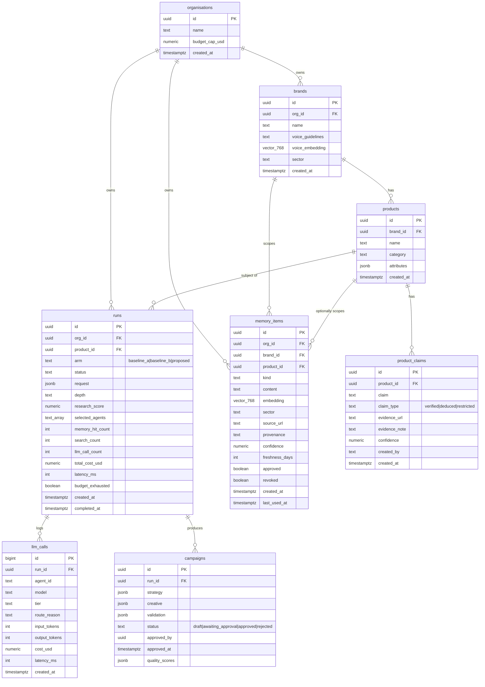

# BrandverseAI — Data Model (ERD draft)

| Field | Value |
|---|---|
| Phase | 0 — draft for review |
| Source of truth | `Architecture.md` §9, `Memory.md` §5 |
| Date | 14 October 2026 |

This diagram reproduces `Architecture.md` §9 as written. It is not a migration. Open issues found
while drawing it are listed in §2 and must be resolved before the Phase 1 migrations are written.

## 1. Diagram

## 2. Open issues — need a decision before Phase 1

| # | Issue | Why it matters | Proposed resolution |
|---|---|---|---|
| E1 | `products`, `product_claims`, `llm_calls`, `campaigns` have no `org_id` | Rules.md P3/P4 and §9's RLS rule are written against `org_id`. Without it, RLS on these tables needs a join-based policy, which is slower and easier to get wrong. | Add a denormalised `org_id` to all four, enforced by FK, with a direct RLS policy |
| E2 | `memory_items` has no `embedding_model` / `embedding_version` columns | `Memory.md` §5 says store them from day one; §9 DDL omits them | Add both columns, `not null` |
| E3 | `brands.voice_embedding` has no model/version columns either | Same drift risk as E2 for the brand-voice gate | Add `voice_embedding_model`, `voice_embedding_version` |
| E4 | No audit columns for revocation (`revoked_by`, `revoked_at`) | `Memory.md` §6.4 requires recording who revoked what and when | Add both to `memory_items` |
| E5 | `product_claims` (verified) are retrieved via `memory_items.kind='claim'`, but no link between the two tables | Decay exemption in `Memory.md` §3.3 keys on `claim_type`, which lives only on `product_claims` | Add nullable `memory_items.claim_id` FK to `product_claims` |
| E6 | `memory_items.provenance = 'seed'` is the only seed marker | `Rules.md` A3 requires seed exclusion enforced in code; a free-text field is fragile | Add `is_seed boolean not null default false` |

E1 touches tenant isolation, so per `Rules.md` §1.2 it is not applied without sign-off.
